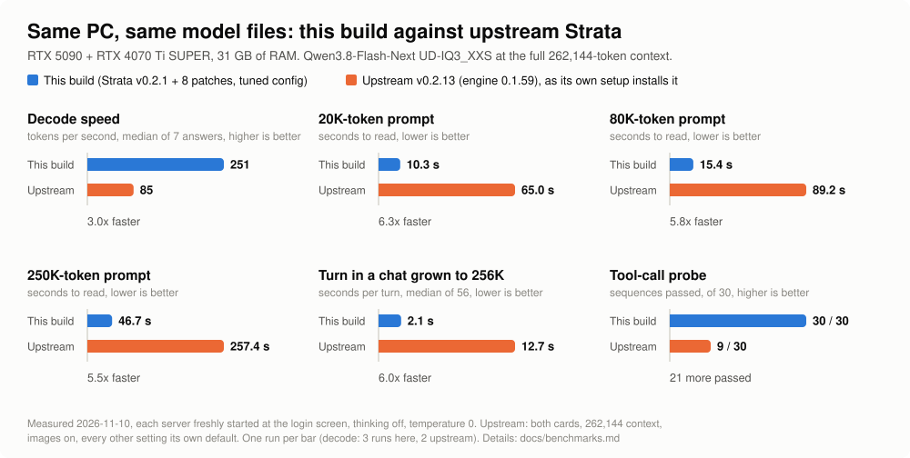

# strata-5090-4070

> Qwen3.8-Flash-Next with the **full 262,144-token context** on an RTX 5090 + RTX 4070 Ti SUPER and 31 GB of RAM.

<p>
  <a href="https://github.com/ExTV/strata-5090-4070/actions/workflows/patches-apply.yml"></a>
  <a href="LICENSE"></a>
</p>

<picture>
  <source media="(prefers-color-scheme: dark)" srcset="docs/comparison-dark.svg">
  
</picture>

A patched build and a tuned config of [Strata](https://github.com/Niko1221/Strata) for one specific box: a
32 GB card, a 16 GB card in a chipset x1 slot, and less RAM than the model's expert file. It is the exact setup
that serves my own agents every day.

- **3x the decode speed and 5.5-6.3x faster prompts** than upstream Strata sets up on the same PC
- **The whole 262,144-token window** with nothing swapped out on 31 GB of RAM
- **Decode never reads the SSD:** every expert outside VRAM, and every cache slot a prompt borrows, sits in locked RAM
- **Agent-ready tool calls:** 30 of 30 on a probe that edits a file documenting the call format
- **Images**, a runtime refusal-direction projection, OpenAI and Anthropic compatible API on `:8888`

## Quick start

```bash
git clone https://github.com/ExTV/strata-5090-4070.git && cd strata-5090-4070
./install.sh                    # clone Strata v0.2.1, apply patches, build engine + vision helper, venv
# download the model (Install, step 2), then:
./prepare.sh                    # dense pack, MTP drafter, the Sharp chat template at xhigh, the Q8_0 PLE table
launchers/flash-next-262k.sh    # serves http://127.0.0.1:8888/v1
```

[Benchmarks](docs/benchmarks.md) · [Quality](docs/quality.md) · [How it works](docs/how-it-works.md) · [Tuning](docs/tuning.md) ·
[Patches](docs/patches.md) · [Tools](docs/tools.md) · [Issues](https://github.com/ExTV/strata-5090-4070/issues)

## Performance

Measured 2026-11-10 on the same PC with the same model files (Unsloth UD-IQ3_XXS, 262,144 context, images on),
each server freshly started at the login screen, thinking off, temperature 0.

| | Upstream v0.2.13 | This build |
| --- | --- | --- |
| Decode, tokens per second (median of 7 answers) | 84, 86 | **250, 251, 254** |
| Decode, ms per verify window | 36.3, 38.0 | **10.2** |
| 20K-token fresh prompt | 64.1 s, 65.9 s | **10.3 s** |
| 80K-token fresh prompt | 89.2 s | **15.4 s** |
| 250K-token fresh prompt | 257.4 s | **46.7 s** |
| Read from the SSD for the 80K + 250K prompts | 761 GiB | **18 GiB** |
| A turn in a chat grown to 256K tokens (median of 56) | 12.7 s | **2.1 s** |
| Tool-call probe (`tools/tool_probe.py 30`) | 9 / 30 | **30 / 30** |

- **Upstream** is v0.2.13 with its ready-made engine 0.1.59, installed by its own `setup.sh` for both cards
  (`--gpus 0,1 --context 262144 --vision gpu`), every other setting its default: it puts layers 0-10 on the
  4070 and 11-47 on the 5090, keeps 8 GiB of experts in RAM and uses the model's stock chat template
- **This build** is Strata v0.2.1 with the 8 patches and the config in this repository
- The needle hidden in each long prompt came back on both
- One run per row unless several values are listed. How each gain was found:
  [docs/benchmarks.md](docs/benchmarks.md); older builds and quants: [docs/history.md](docs/history.md)

## Output quality

Measured 2026-11-10 on the shipped config. Methods and every row: [docs/quality.md](docs/quality.md).

| Check | Reference | This build |
| --- | --- | --- |
| Perplexity, 25,500 WikiText-2 tokens, same model files | llama.cpp: 3.2079 | 3.2115 (+0.11%) |
| Same most likely token as llama.cpp | | 95.1% |
| LiveCodeBench v6, 175 problems, thinking off | Qwen3.8 Flash API: 118 (67.4%) | 109 (62.3%) |

- Perplexity matches llama.cpp on the same files; the output is not token-for-token the same, with this
  repository's tuning (95.1%) or without it (95.2%)
- The tuning switches reorder the math and are not bit-exact: 96.7% the same top token as with them off, at
  equal perplexity
- LiveCodeBench compares a 3.5-bit quant with the hosted model; 175 problems put the 5-point gap inside the
  noise (p = 0.12), and it does not isolate the speed work

## Requirements

- **GPUs:** an RTX 5090 (or another 32 GB Blackwell card) plus a 16 GB NVIDIA card, which can sit in a chipset
  x1 slot. The layer split (39) and the VRAM reserves are sized for exactly 32 + 16 GB
- **RAM:** 32 GB. With the server up, 3 GB stays available at idle and 1.7 GB at the end of a 256K chat
- **Boot it at the login screen.** Started under a desktop with a browser open, the engine shrinks its RAM
  copy by itself (11.5 instead of 14.7 GiB here) and decodes about 26% slower per window
- **Disk:** a fast NVMe with ~140 GB free (55 GB of experts, the 29 GB shard 4, the 54 GB Q8_0 PLE table)
- **Software:** Linux, NVIDIA driver, CUDA toolkit (`nvcc`), `cmake`, `ninja`, `git`, `patch`, `curl`, Python 3.10+

## Install

### 1. Build

```bash
./install.sh
```

- Clones upstream Strata at tag v0.2.1 into `./strata` and applies `patches/` in order
- Builds the engine and the vision helper for sm_89 + sm_120, creates the venv
- Writes the three configs (see [Configs](#configs)) and checks the patched files against `patches/MANIFEST.sha256`
- Safe to re-run

| Variable | Default | Purpose |
| --- | --- | --- |
| `MODELS` | `./models` | where the GGUF files live; written into the configs |
| `JOBS` | `3` | parallel compile jobs (~3 GB of RAM each) |
| `CUDA_ARCHS` | `89;120` | GPU architectures to build |
| `STRATA_GGML_DIR` | | a local llama.cpp checkout at the pinned commit |

### 2. Download the model

```bash
strata/.venv/bin/pip install -U huggingface_hub
strata/.venv/bin/hf download unsloth/Qwen3.8-Flash-Next-GGUF --include "UD-IQ3_XXS/*" --local-dir models
strata/.venv/bin/hf download ISTA-DASLab/Qwen3.8-Flash-Next-GSQ-RCO-GGUF --include "mmproj-*" --local-dir models
strata/.venv/bin/hf download alesha-pro/Qwen3.8-Flash-Next-abliterated-GSQ-RCO-Strata-GGUF Huihui-Qwen3.8-Flash-Next-refusal-direction-r.gguf --local-dir models
./prepare.sh
```

- All four UD-IQ3_XXS shards are needed (shard 1 declares a four-file split), although the config reads
  Unsloth's Q8_0 PLE table instead of the IQ4_NL one in shard 4
- `prepare.sh` builds the pack, the MTP draft runtime and the tokenizer with the
  [Sharp chat template](https://huggingface.co/peculiar-ragdoll/Qwen-Sharp-Chat-Templates) at xhigh effort,
  then downloads the Q8_0 PLE table (54.4 GB) and patches 82 bytes of its header so v0.2.1 loads it
  (`tools/ple_header_patch.py`; `--restore` undoes it)
- The control vector (480 KB) is the refusal direction of huihui-ai's abliterated release, applied at runtime.
  Leave the four `--control-vector*` / `--cvec*` arguments out of the config for the stock model
- ISTA quants instead: download `"IQ3_S/*"` (or `"IQ3_XXS/*"`) from the ISTA repository as well and run
  `QUANT=IQ3_S ./prepare.sh`

### 3. Run

```bash
launchers/flash-next-262k.sh
```

- Serves `http://127.0.0.1:8888/v1`: OpenAI chat completions and Anthropic messages, model name `qwen3.8-flash-next`
- Overrides: `CONFIG=` (another config), `PORT=`, `HOST=`
- Strata v0.2.1 refuses to bind to anything but loopback without an API key: for `HOST=0.0.0.0` give the server
  one (its `--help` lists the ways); clients send it as a Bearer token
- Reasoning effort defaults to xhigh; a request's `reasoning_effort` (`none` .. `xhigh`) or
  `chat_template_kwargs.enable_thinking: false` overrides it
- Keep `"presence_penalty": 0.0` and `"STRATA_HC_Q8": "0"` in the config: the first default sends
  thinking-off requests down a slower serial decode loop, the second garbles tool-call arguments on this build

## Configs

| Config (`CONFIG=`) | Model | Notes |
| --- | --- | --- |
| `strata-flash-next-ud-iq3xxs-262k.json` (default) | Unsloth V3.1 UD-IQ3_XXS + Unsloth's Q8_0 PLE table | what runs here every day; no conversation parking, sized for 31 GB |
| `strata-flash-next-262k.json` | ISTA GSQ-RCO IQ3_S + the FP8 PLE table | the daily config until 2026-11-04; parks conversations and spills big ones to the SSD |
| `strata-flash-next-iq3xxs-262k.json` | ISTA GSQ-RCO IQ3_XXS | carried forward, not booted on the v0.2.1 build |

What makes the default fast on this box, in short (the full tables with measurements: [docs/tuning.md](docs/tuning.md)):

- **Layer split 39:** layers 0-38 on the 5090, 39-47, the drafter and the image encoder on the 4070, which holds every expert of its layers
- **Prompts read on the 5090** in 4,096-token chunks, each card running its own layers (`--prefill-main`, ours)
- **A 14.7 GiB locked RAM copy** holds all experts outside VRAM plus every cache slot the prompt path borrows
- **Thread placement** for a hybrid CPU: `--aux-cpus auto --host-core sibling`
- **The Sharp chat template at xhigh** and a nesting-aware tool-call parser

## Patches

Applied to v0.2.1 in order, they rebuild the tested tree byte for byte (48 files, checked in CI). Full
descriptions: [docs/patches.md](docs/patches.md).

| # | Source | In one line |
| --- | --- | --- |
| 01 | ours + carried PRs | the dual-GPU series: `--prefill-main`, split-wise prompt reads, the SSD spill, the parser fix, `--kv-resident-later` |
| 02 | PR #3404 | superseded parked conversation copies are dropped |
| 03 | upstream 70f42407 | a tool call counts only when it names a declared tool; drifted envelopes are read |
| 04 | ours | spill restore fix, and no speculative spill writes while idle |
| 05 | ours | prompt parts with pictures read split-wise like text |
| 06 | upstream #3470, #3350, #3602 | a VRAM leak per long cold prompt, a checkpoint copy failure that ended requests, a PLE read hang |
| 07 | PR #4844 | experts lost after a pipelined adaptive round (decode drifting down over hours) |
| 08 | PR #5108 | an out-of-bounds read that faulted long prompts on the second card |

## Tools

All talk to `127.0.0.1:8888` unless `STRATA_URL` is set. The full list: [docs/tools.md](docs/tools.md).

| Script | Measures |
| --- | --- |
| `tools/window_bench.py [TAG]` | ms per verify window over 7 short answers and a 20K prompt: the A/B gate for any change |
| `tools/prompt_bench.py WORDS...` | fresh prompts with a hidden needle (`23700 74000` = 80K and 250K tokens) |
| `tools/grow_chat.py [LIMIT]` | one chat grown to the context limit: seconds per turn, decode, available RAM |
| `tools/tool_probe.py [N] [TAG]` | the two-turn agent tool-call probe |
| `tools/engine_logprobs.py` | per-token log-probabilities from the engine: perplexity, and agreement with llama.cpp |
| `tools/make_comparison_chart.py` | redraws the image at the top from the numbers in the script |

## Status

- The patch series is checked in CI against a pristine v0.2.1 checkout
- `install.sh` and `prepare.sh` have not been run end to end from a clean checkout; the UD-IQ3_XXS steps of
  `prepare.sh` were done by hand here. Reports welcome
- This build stays on v0.2.1 on purpose: the comparison above is against v0.2.13, and the two later fixes that
  mattered here are carried as patches 07 and 08

## License

MIT ([LICENSE](LICENSE)). Strata is MIT ([LICENSE.strata](LICENSE.strata)). The Sharp chat template that
`prepare.sh` downloads is Apache-2.0 (peculiar-ragdoll); the control vector is from alesha-pro's release.
